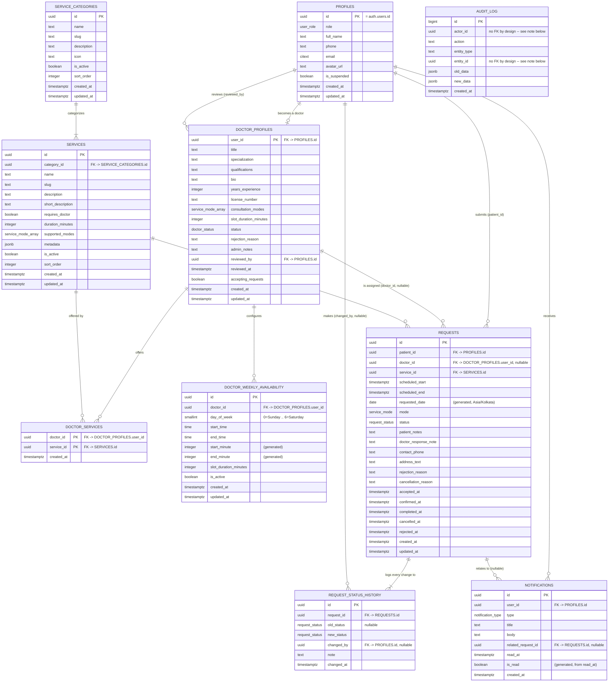

# Data model

This is the current schema exactly as implemented across all migrations
through `20261112000015_missing_indexes.sql`. Columns are listed in full;
types are abbreviated where Postgres's name is verbose (e.g. `timestamptz`
not `timestamp with time zone`). Generated columns are marked `(generated)`.

## Entity-relationship diagram

Note: `PROFILES.id` itself is a foreign key to `auth.users.id` (`ON DELETE
CASCADE`) -- Supabase Auth's own table, not shown above since this
diagram covers `public` schema tables only.

`AUDIT_LOG.actor_id`/`entity_id` are deliberately **not** foreign keys --
`entity_type` varies per row (`'doctor_profiles'`, `'requests'`,
`'profiles'`, `'service_categories'`, `'services'`, ...), so `entity_id`
can't reference one single table, and `actor_id` can be null for
system-initiated actions. See the table's own comment
(`20261111120014`-era migration) and `docs/rpc-reference.md`'s `log_audit()`
section.

## Enums

| Enum | Values |
|---|---|
| `user_role` | `user`, `doctor`, `admin` |
| `doctor_status` | `pending`, `approved`, `rejected`, `suspended` |
| `request_status` | `requested`, `accepted`, `confirmed`, `completed`, `rejected`, `cancelled` |
| `service_mode` | `in_person`, `home_visit`, `online` |
| `notification_type` | `request_created`, `request_accepted`, `request_rejected`, `request_confirmed`, `request_cancelled`, `request_completed`, `doctor_approved`, `doctor_rejected`, `doctor_suspended`, `system` |

## Key constraints not visible in the ER diagram

- `doctor_weekly_availability_no_overlap`: GiST `EXCLUDE` on
  `(doctor_id, tstzrange(start_minute, end_minute))` per day -- two
  availability windows for the same doctor on the same day can never
  overlap.
- `requests_no_doctor_overlap`: GiST `EXCLUDE` on `(doctor_id,
  tstzrange(scheduled_start, scheduled_end))`, scoped to `status IN
  ('accepted', 'confirmed')` only -- deliberately does **not** block two
  different patients both having a `requested` hold on the same slot; the
  doctor accepting one is what makes the constraint start blocking the
  other.
- `requests_patient_doctor_start_unique`: partial unique index on
  `(patient_id, doctor_id, scheduled_start)`, scoped to `status IN
  ('requested', 'accepted', 'confirmed')` -- the same patient can't have
  two simultaneously-active requests with the same doctor at the same
  time.
- `requests_home_visit_address`: CHECK -- `mode = 'home_visit'` requires
  `address_text IS NOT NULL`.
- `request_status_history` and `audit_log` are both append-only: a
  `BEFORE UPDATE OR DELETE` trigger (`reject_update_or_delete()`) rejects
  any attempt to modify or remove a row, for every role including the
  table owner, by design -- see `docs/performance.md`'s note on what this
  means for ever deleting a `requests` row.

## Views (not part of the ERD -- derived, not stored, data)

| View | Backed by | Purpose |
|---|---|---|
| `doctors_public` | `doctor_profiles` + `profiles` | Public-safe doctor listing (approved, not suspended; never exposes `license_number`/`admin_notes`/email/phone) |
| `doctor_services_public` | `doctor_services` + `doctor_profiles` + `profiles` + `services` | Public-safe "which doctors offer this service" |
| `doctor_patient_contacts` | `requests` + `profiles` | A doctor's linked patients' names only (id + full_name, never phone/email) |
| `doctor_request_contacts` | `requests` | A patient's `contact_phone`, masked to NULL unless the request is `accepted`/`confirmed` |
| `patient_requests_view` | `requests` + `services` + `doctors_public` | A patient's own requests with service name + doctor's public name/specialization |
| `doctor_requests_view` | `requests` + `services` + `doctor_patient_contacts` + `doctor_request_contacts` | A doctor's own assigned requests with service name + patient's name + status-masked phone |

Full column lists, RLS policies, and security-definer-vs-invoker
decisions for each are in `docs/security-principles.md` and
`docs/rpc-reference.md`.
